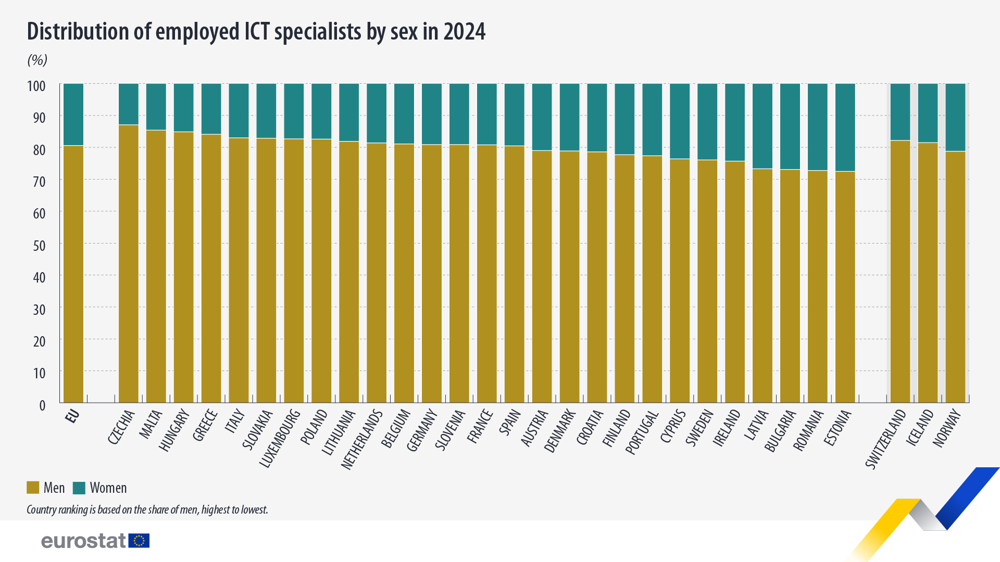

Europe says it has a shortage. Under the Digital Decade programme, the EU has set a target of 20 million ICT specialists by 2030. Its own research agency now projects a shortfall of around five million. Women made up fewer than one in five ICT specialists already in post in 2024: just 19%. The agency presents closing this gap as an economic necessity, since without women the Union draws on less than three quarters of its potential talent pool.[^eurofound]

Let's first define shortage. Is it just the number of people available falls below the number an economy says it needs? Europe's figure of 20 million is a target built around a growth ambition where women appear as a reserve of talent waiting to be recruited. But why so many are outside the sector in the first place?

The familiar diagnosis is a leaky pipeline. Women enter education and training, then gradually disappear from technical careers. This captures a real pattern, which might be a symptom of the structure producing it. What if the _leak_ is only the visible edge of a broader arrangement? The academic system, among many others, prefers in indirect ways a worker with a body without needs, time with flexible limits and no responsibilities of care outside of work. Therefore, the question may be no longer simply how to repair the leaky pipeline, but also, what institutions reward as _efficiency_, _merit_, _choice_ and _growth_.

Start with the numbers. Women make up just over a third of researchers in the EU, at 34%, and only about 22% of doctoral graduates in STEM and ICT fields.[^shefigures] Since women outnumber men in higher education overall, the loss happens along the way, not simply at the point of entry.[^shefigures] In ICT employment, women accounted for 19.5% of specialists in 2024.[^eurostat]

*Figure 1. Women's share of ICT specialists by EU country, 2024. Source: Eurostat.*

Moreover, the gender pay gap in the wider information and communication sector was close to 20% in 2022, compared with 13% across the economy as a whole. Women specialists also report lower satisfaction with pay, less paid training and higher work intensity.[^eurofound] A 2024 cluster analysis of Eurostat data suggests that the pay gap may deter women from entering the field, rather than simply emerging after entry, although the study is correlational.[^studiaeuropejskie] The numbers show where exclusion lands. To understand why, the focus has to shift from women's choices to the kind of worker the system assumes.

## Who is the ideal worker?
Picture the researcher an institution is more likely to reward: mostly available, barely distracted, quite free to change working location at short notice and devoted to the job. This is the ideal worker, the figure named by sociologist Joan Acker in a paper in 1990.[^acker] The ideal worker has no caring responsibilities and a body that doesn't need accommodating, and is therefore an abstraction that erases the actual conditions in which people work, such as those of care, illness, disability, ageing and the limits of time and energy, which is a convenient illusion.

The political theorist Joan Tronto calls the ability to avoid care because someone else carries it _privileged irresponsibility_. It allows a person to experience self-sufficiency while depending on invisible labour.[^tronto] Dependency is not an interruption of normal, adult life. Everyone begins in it, many end in it, and those who care for dependants become dependent in turn on a society capable of sustaining them.[^kittay] The apparently autonomous researcher is not self-sufficient, but that autonomy is maintained by other people's labour.

This is not a new observation. Italian feminists writing in the 1970s made a related argument about the factory, where paid production is supported by unpaid domestic and reproductive labour.[^dallacosta] A similar tension runs through universities and research institutions. Capital needs workers, but resists paying the full costs of reproducing the people who supply that labour.[^picchiofraser]

For example, what if a worker has a child? A longitudinal US study of new parents in STEM, published in 2019, found that 43% of mothers left full-time STEM employment after the birth of a first child. The same was true of 23% of fathers.[^cech] Therefore, parenthood can push men out of full-time STEM work too, suggesting that the jobs themselves are hostile to responsabilities of care, but the gap between the figures shows who is expected to absorb more of the cost, making the ideal worker not gender-neutral.

The assumption can follow women into the hiring room. Questions about whether a candidate plans to have children are still sometimes directed at women in ways male candidates rarely experience, implying that a woman's possible future caregiving is treated as a risk for the employer, not as a shared social responsibility.

The ideal worker abstraction also abolishes embodiment, but bodies can become pregnant, can fall ill, age, grieve and reach limits. Yet the always-available body remains the standard against which disabled researchers, among others, are measured.[^brown] Every biologist knows that an organism has a range of tolerance beyond which its performance collapses. Research institutions nevertheless behave as if their ideal worker has no such range. Consider doctoral researchers in Italy, who have no clearly established framework for sick leave. When illness interrupts their work, arrangements are left to individual supervisors and students to negotiate. There is no consistent procedure, no guarantee that the need to rest will be respected, and no institutional framework to protect it. Something as basic as being ill becomes a matter of goodwill rather than an acknowledged right of the doctoral researcher. This is a concrete example of an institutional failure.

Who benefits from this structure? Employers and universities obtain labour without paying the full costs of it; states avoid building the care infrastructure that would make this illusion of the ideal worker unnecessary. Those able to present constant availability as a personal virtue, rather than a privilege or luck, are more likely to receive the credit.

## Pack light, but publish heavy
The ideal worker is expected to be free to move wherever the next opportunity takes them. Contemporary capitalism has absorbed earlier critiques by reorganising work around _the project_. The valued worker is mobile, flexible, networked and ready for the next engagement.[^boltanski] In European universities, national and international mobility often functions as a criterion of excellence and a sign of ambition, but the freedom to move is not equally available to everyone, making mobility expectations potentially operate as indirect discrimination against people with other responsibilities that tie them to a place.[^ackers]

Italy offers a particularly stark example. The PNRR, the national recovery plan financed by European funds, financed laboratories and fixed-term researcher posts, then came to an end. Around 9,000 fixed-term researcher contracts and 23,500 research fellowships (_assegni di ricerca_) were due to expire between 2025 and 2026, while only a little over 2,600 people had been hired with PNRR funds. Universities had also used the _assegno_, tied to a single project, to obtain research labour at relatively low cost.[^cgil] The result is that public funding financed infrastructure and short-term positions, but failed to provide stable employment for the researchers needed to run the new facilities.

The numbers also describe an early researcher's sense of the future. A 2024 survey by ADI (Associazione Dottorandi e Dottori di Ricerca Italiani, the Italian Association of PhD Candidates and PhDs) of 2,888 researchers in Italian universities and research centres found that many described themselves as precarious and unable to see a future.[^adi] The doctoral and postdoctoral association behind the survey has also lodged a complaint with the European Commission about two new research contracts that, it warns, could reintroduce structural precarity. The same report identifies a gender divide alongside a territorial one.

Why does this instability weigh especially heavily on women? The concept of the feminisation of labour offers one answer. Conditions historically assigned to women's work, i.e. intermittency, flexibility, affective effort and unpaid labour that sustains paid work, have increasingly become the general conditions of employment.[^morini] Many of the conditions now imposed on everyone were long familiar features of women's working lives, and when unstable income, location and working hours collide with care obligations that cannot be postponed, the costs multiply.

Picture a biologist in her mid-thirties, on her third fixed-term contract in as many cities. Each job change interrupts the research itself, so the cost is not just personal. Research takes time, and when contracts last two or three years, knowledge that depends on continuity is produced by people who are constantly starting again.

## Who gets credit for the work?
Studies of professorial appointments in the Netherlands show how the very construction of “excellence” can be shaped by gendered practices.[^vandenbrink] A US study of research teams found that women were 13% less likely than men to be credited as authors on articles and 58% less likely to be credited on patents.[^ross] Survey respondents in the same study reported that women did more of the conceptualising, data curation and writing, which is essential for holding a project together.[^ross]

Science depends on collaboration, but rewards are often organised around individuals. A study is the result of the labour of technicians, curators, reviewers and teachers as well as principal investigators. Yet, its main currencies of reward, such as authorship order, individual grants and prizes, attach credit to a small number of named people. Engineering has similarly been described as organised through a technical/social dualism, in which “hard” work is prestigious while relational work is not.[^faulkner]

The same question reaches into the ideal of _scientific objectivity_. Feminist philosophers have challenged the idea of a "view from nowhere", arguing that it can conceal the position of the person doing the looking. The alternative is a _situated objectivity_ that acknowledges the conditions and perspectives that shape its knowledge.[^haraway] A claim to see from nowhere can simply offer one point of view into the universal one.

## When the system calls it choice
When women are underrepresented, _choice_ often crosses the discussion. Perhaps women are less numerous in technical fields because they simply prefer something else? Experiments on tournament pay schemes (competitive systems in which rewards go to those who outperform others) have found that men enter them more often than equally able women.[^niederle] The result is often read as evidence of women's aversion to competition, however we can also look at it as who is choosing, from which options, and under what conditions. A preference is also shaped by what has historically been affordable, rewarded and safe. Choice looks free only when the conditions surrounding the alternatives are left out.

This is where the figure of the _entrepreneur of the self_ enters the picture. Neoliberal governance turns each person into a manager of their own human capital, responsible for continuously improving and marketing themselves.[^foucault] The philosopher Byung-Chul Han describes the resulting achievement-subject as one that exploits itself while experiencing that exploitation as freedom.[^han] Within this logic, a structural difficulty becomes a personal shortcoming, and then self-confidence and resilience become the tools through which people are encouraged to manage that shortcoming, individualising what may be a reasonable response to an environment that routinely withholds recognition.[^impostor]

A representative sample of 3,659 PhD students from Flanders found that 32% were at risk of a common psychiatric disorder. The factors associated with that risk were organisational, such as the interface between work and family, job demands and control, supervisors' leadership styles, team decision-making culture, and perceptions of career prospects outside academia.[^levecque] The study is cross-sectional and cannot establish causation. Even so, its findings point towards working conditions rather than individual failure.

## Manufacturing a shortage
The figures bring the argument back to the shortage itself. ICT employment in the EU has grown by 7 to 8% a year, compared with just over 1% for employment overall, rising from 5.6 million specialists in 2011 to 10.3 million in 2024. ICT jobs also score above average on most measures of job quality. Even so, policy recommendations place considerable emphasis on expanding the domestic supply of digital talent and facilitating mobility and less so on improving job quality. Over three years, the share of specialists born outside the EU rose from 9% to 12%.[^eurofound]

Here is the loop: a growth target defines a shortage; the shortage defines a deficit of people; and that deficit is addressed by drawing on populations the system has not yet fully recruited, i.e. women, migrants and the young. The target itself remains largely untouched. Limits, however, can also be chosen, as a form of collective self-limitation, [^kallis] because a system that must always expand turns every boundary into an obstacle.[^hickel] The feminist critique of productivism and the ecological critique are two sides of the same coin. Both the worker and the planet are assumed to have no limits, because capital accumulation depends on treating some people's labour as free and invisible.[^mies] The result is a cannibal logic in which the system consumes the conditions of its own reproduction, demolishing the bodies that sustain it and the ecosystems on which it depends.[^fraser2022]

So lastly, I ask myself, what is science for? Obviously there is no single answer, but the idea of _slow science_ offers one way to approach it, where research is attentive to the relevance of its questions and to the people and places affected by them, instead of governed primarily by accelerating metrics.[^stengers] The question is even more urgent today as generative AI makes it possible to produce text, code and analysis faster than ever. The pressure to publish more can easily outrun the time needed to ask whether the work is worth doing (and on a side note, I suggest taking a glance at [The Machine Consumes Itself: Artificial Intelligence and the End of Publish-or-Perish](https://link.springer.com/article/10.1007/s42438-026-00666-0)). If the problems most in need of research are long-term, systemic and ecological, a system organised around grant cycles, output counts and disposable labour is poorly matched to them, making the ideal researcher an unjust and badly adapted model to answer the questions that most need answering.

## Imagining a different research environment
If the problem is a model of work rather than a leaky pipeline, better recruitment alone will not fix it. What would have to change in the research environment itself?

Obviously I don't have all the answers, but let's start with security. If precarity is the clearest expression of the availability norm, stable posts are a form of gender policy. No one can plan a life around a contract that ends in eighteen months. ADI and the union FLC CGIL have challenged the conditions of precarity described above. Public research funding could make contract quality a condition of access, but security must be designed without simply closing the door behind those already inside.

Next, an institution that keeps capacity in reserve for illness, caregiving and recovery may look inefficient on the old ledger. In reality, it is counting needs that the ledger left out. Care must also be treated as a shared responsibility. Tronto's concept of _caring with_ frames care as a shared responsibility, one that must be taken up collectively by institutions and democratic societies, not left to individuals to manage on their own.[^trontowith]

What about the judgement of work? The Coalition for Advancing Research Assessment (CoARA), with more than 800 signatory organisations, promotes qualitative and narrative assessment that recognises mentoring, data, software and public engagement.[^coara] There are certainly limits, given that the agreement is not legally binding, progress is self-reported, and its effect on who receives credit has yet to be established. Gender equality plans, which research organisations are expected to have under Horizon Europe, face the same test. A plan on paper changes little unless it changes contracts, workloads and the distribution of recognition.

Finally, consider who owns and governs research. A democratic ethos does not automatically produce parity.[^schmidt] Public procurement and ethical-finance instruments could help create the conditions to test these alternatives. Worker cooperatives, such as those associated with the Basque Mondragon federation, and democratically governed research collectives offer models built around shared goals and competence is defined by the tasks accomplished. Democratic structures can help women participate, but male-dominated cultures, restrictive bylaws and informal networks can still limit access. 

None of these changes will come from goodwill alone. Gains in European labour history have come through **collective pressure**. Researchers' associations, unions and mutual-aid networks among postdoctoral workers have a direct interest in changing the model. The practical question is where that pressure can begin inside existing workplaces.

## Wrong question, right anger
"How can Europe get more women into STEM?" is entirely reasonable, but it risks narrowing the debate to a question of recruitment. Let's ask more often what STEM asks of anyone, and what it takes for granted from a researcher. The standard itself is incompatible with human limits (and, by extension, with the limits of a finite planet). Because ultimately, the shortage can be real, but it may also be the shape taken by a refusal to reconsider something else, so the question is not simply how to fill the pool, but what the system has been draining.

## Sources
- Acker, J. (1990). Hierarchies, jobs, bodies: A theory of gendered organizations. Gender & Society, 4(2), 139–158. philpapers.org/rec/ACKHJB
- Ackers, L. (2008). Internationalisation, mobility and metrics: A new form of indirect discrimination? Minerva, 46(4), 411–435. philpapers.org/rec/ACKIMA
- Avvenire, on the ADI survey. «Siamo precari, non vediamo un futuro»
- Boltanski, L. and Chiapello, È. (1999). Le nouvel esprit du capitalisme. Paris: Gallimard. 
- Bourdieu, P. (1984). Homo Academicus. Paris: Minuit. 
- Bourdieu, P. (1998). La domination masculine. Paris: Seuil. 
- Brown, N. and Leigh, J. (eds.) (2020). Ableism in Academia. London: UCL Press. doi:10.14324/111.9781787354975 (open access)
- Cech, E.A. and Blair-Loy, M. (2019). PNAS, 116(10). doi:10.1073/pnas.1810862116
- CoARA, Agreement on Reforming Research Assessment
- D'Alisa, G., Demaria, F. and Kallis, G. (eds.) (2014). Degrowth: A Vocabulary for a New Era. London: Routledge. 
- Dalla Costa, M. and James, S. (1972). The Power of Women and the Subversion of the Community. Bristol: Falling Wall Press. (Italian original: Potere femminile e sovversione sociale, Padova: Marsilio, 1972.)
- Eurofound (2026). IT sector in focus: Evolution of the EU's digital workforce, and its press release
- European Commission, She Figures 2024, country sheet (DE), with a summary
- Eurostat 2024 ICT specialist data, via a BCCI Bulgaria summary
- Faulkner, W. (2000). Dualisms, hierarchies and gender in engineering. Social Studies of Science, 30(5), 759–792. doi:10.1177/030631200030005005
- Feenstra, S., Begeny, C.T., Ryan, M.K., Rink, F.A., Stoker, J.I. and Jordan, J. (2020). Contextualizing the impostor "syndrome". Frontiers in Psychology, 11, 575024. doi:10.3389/fpsyg.2020.575024
- Foucault, M. (2004). Naissance de la biopolitique: Cours au Collège de France, 1978–1979. Paris: Seuil/Gallimard. 
- Fraser, N. (2016). Contradictions of capital and care. New Left Review, 100, 99–117. newleftreview.org
- Fraser, N. (2022). Cannibal Capitalism. London: Verso. 
- Han, B.-C. (2010). Müdigkeitsgesellschaft. Berlin: Matthes & Seitz. 
- Haraway, D. (1988). Situated knowledges: The science question in feminism and the privilege of partial perspective. Feminist Studies, 14(3), 575–599. doi:10.2307/3178066
- Hickel, J. (2020). Less Is More. London: Heinemann. 
- Il Post (15 December 2025). Perché migliaia di ricercatori universitari perderanno il lavoro
- Kallis, G. (2019). Limits. Stanford: Stanford University Press. 
- Kittay, E.F. (1999). Love's Labor. New York: Routledge. 
- Levecque, K. et al. (2017). Work organization and mental health problems in PhD students. Research Policy, 46(4). doi:10.1016/j.respol.2017.02.008
- Mies, M. (1986). Patriarchy and Accumulation on a World Scale. London: Zed Books. 
- Morini, C. (2010). Per amore o per forza: Femminilizzazione del lavoro e biopolitiche del corpo. Verona: Ombre Corte. 
- Niederle, M. and Vesterlund, L. (2007). Do women shy away from competition? Do men compete too much? Quarterly Journal of Economics, 122(3), 1067–1101. doi:10.1162/qjec.122.3.1067
- Picchio, A. (1992). Social Reproduction: The Political Economy of the Labour Market. Cambridge: Cambridge University Press. ISBN 978-0-521-41872-0.
- Ross, M.B. et al. (2022). Women are credited less in science than men. Nature, 608. doi:10.1038/s41586-022-04966-w
- Schmidt, S. de S., da Silva, E.D. and Romeo, M. (2026). Gender diversity in cooperative boards: Favoring and hindering factors in a scoping review. Voluntas, 37(1), 38–72. doi:10.1017/S0957876526000100
- Stengers, I. (2018). Another Science Is Possible. Cambridge: Polity. 
- Studia Europejskie (2024). Women in the ICT sector in European Union states
- Tronto, J. (1993). Moral Boundaries. New York: Routledge. 
- Tronto, J. (2013). Caring Democracy. New York: NYU Press. 
- Tulshyan, R. and Burey, J.-A. (2021). Stop telling women they have imposter syndrome. Harvard Business Review, 11 February. hbr.org
- Van den Brink, M. and Benschop, Y. (2012). Gender practices in the construction of academic excellence: Sheep with five legs. Organization, 19(4), 507–524. doi:10.1177/1350508411414293
## Citation notes

[^eurofound]: Eurofound 2026.
[^shefigures]: She Figures 2024.
[^eurostat]: Eurostat 2024.
[^studiaeuropejskie]: Studia Europejskie 2024.
[^acker]: Acker 1990.
[^tronto]: Tronto 1993, 2013.
[^kittay]: Kittay 1999.
[^dallacosta]: Dalla Costa and James 1972.
[^picchiofraser]: Picchio 1992, Fraser 2016.
[^cech]: Cech and Blair-Loy 2019.
[^brown]: Brown and Leigh 2020.
[^boltanski]: Boltanski and Chiapello 1999.
[^ackers]: Ackers 2008.
[^cgil]: CGIL estimates, in Il Post 2025.
[^adi]: ADI survey, reported in Avvenire.
[^morini]: Morini 2010.
[^vandenbrink]: Van den Brink and Benschop 2012.
[^ross]: Ross et al. 2022.
[^faulkner]: Faulkner 2000.
[^haraway]: Haraway 1988.
[^niederle]: Niederle and Vesterlund 2007.
[^foucault]: Foucault 2004.
[^han]: Han 2010.
[^impostor]: Tulshyan and Burey 2021, Feenstra et al. 2020.
[^levecque]: Levecque et al. 2017.
[^kallis]: Kallis 2019.
[^hickel]: Hickel 2020, D'Alisa, Demaria and Kallis 2014.
[^mies]: Mies 1986.
[^fraser2022]: Fraser 2022.
[^stengers]: Stengers 2018.
[^trontowith]: Tronto 2013.
[^coara]: CoARA 2022.
[^schmidt]: Schmidt, da Silva and Romeo 2026.
